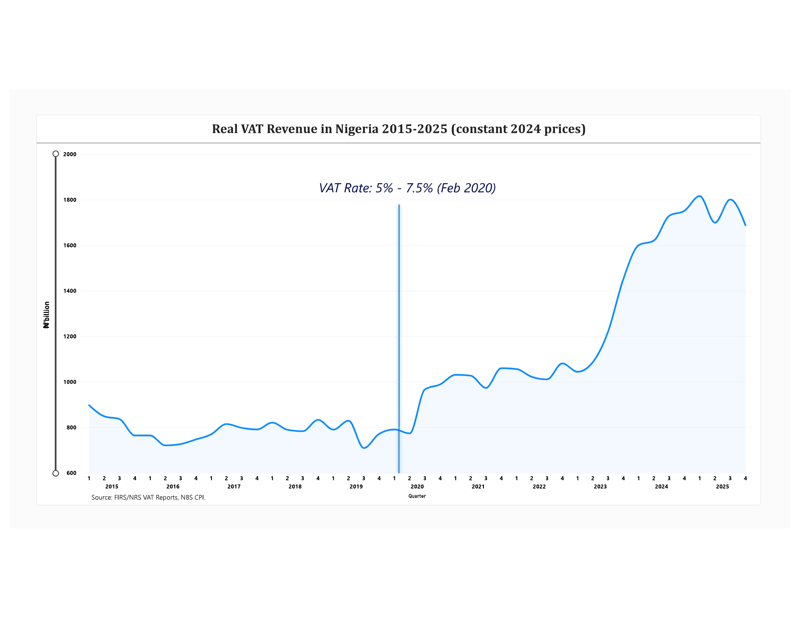

### **Effect of the Increase in the Rate of Value Added Tax on Value Added Tax Revenue Generation in Nigeria**

###### 

###### **Status: Work-in-progress (Started September 2026)**

An Independent applied econometrics project examining the effect of Nigeria's increase in the Value Added Tax rate from 5% to 7.5% (Finance Act 2019, effective 1 February 2020) on VAT revenue generation, once inflation, economic activity and COVID-19 shock are taken into consideration.

#### **Background**

VAT is a crucial tool for domestic revenue mobilization mostly for economies that are looking to strengthen public finances and break the grip of the dependence on volatile revenue sources. In Nigeria, the statutory VAT rate was increase from 5% to 7.5% in February 2020 following the passage of the Finance Act 2019 (Federal Republic of Nigeria, 2019). While the policy reforms aimed to boost government revenue, the actual revenue impact needs to be observable against the backdrop of inflation, economic activity and its after effects. To analyze this, this study considers quarterly VAT revenue series from 2015-2025 in real terms considering the effect of inflation and the degree to which the revenue impact meets the estimated effect based on the government's rate increase estimate.

#### **Research Questions**

1. Did the increase in the VAT rate from 5% to 7.5% raise real (inflation-adjusted) VAT revenue in Nigeria?
2. By how much did real VAT revenue change and how does this compare with the 50% increase in the rate itself?
3. If the increase in revenue was smaller than 50%, what factors explain the gap?

###### 

#### **Research Objectives**

1. Measure the change in real VAT revenue after the February 2020 rate increase.
2. Separate the effect of the rate change from the effects of inflation, economic growth, COVID-19 and exchange rate unification, and compare the estimated increase with the 50% mechanical increase.
3. Discuss possible reasons for any gap, such as compliance, exemptions and weaker consumption.

###### 

#### **Research Hypotheses**

###### **Hypothesis 1: Effect of the rate increase**

* H₀: The increase in the VAT rate from 5% to 7.5% had no significant effect on real VAT revenue.
* H₁: The increase in the VAT rate had a significant positive effect on real VAT revenue.

###### **Hypothesis 2: Size of the effect compared with the rate increase**

* H₀: Real VAT revenue rose in proportion to the rate, i.e. by 50%
* H₁: Real VAT revenue rose by less than 50%

###### **Research Question 3:** (what explains any gap) is addressed in the discussion of results rather than through a formal test because compliance and informality are not directly measured in the data.

##### 

##### 

#### **Literature Review**

##### **Overview of VAT**

Taxes are compulsory levies imposed by the government on individual and business income. Generally, taxes can be broadly categorized into two; direct and indirect taxes.

Value added tax is an indirect form of tax based on the general consumption behaviour of the people (Lumi et al., 2024). VAT is an ad-valorem system of tax that computes amount chargeable based on the total value of the goods bought or service rendered.

The Value Added Tax (VAT) system was introduced in Nigeria through the Value Added Tax Decree No. 102 of 1993, which came into force on January 1, 1994, replacing the Sales Tax Decree No. 7 of 1986, administered by the States (Nwankwo and Nwankwo, 2025).

Since the inception of the VAT into the Nigerian tax system, Nigeria had constantly maintained a rate of 5% over the years until the advent of the Finance Act 2019 which repealed the old rate to an increased rate of 7.5%. The application of the increased rate took effect on 1 February 2020.

##### **VAT Rate Increase and Real VAT Revenue Generation**

It is not surprising that changes in the statutory VAT rate and its effect on revenue have attracted much empirical research within the field of fiscal policy analysis. The dominant theme in this literature is that if VAT is increased, the revenue effect will be positive; if the size of the taxable base, consumption, or the degree of compliance do not change.

In Nigeria, Onaolapo, Aworemi, and Ajala (2013), used ordinary least squares regression to analyze the relationship between VAT receipts and non-oil revenue. Their results showed a strong positive association between VAT receipts and the country's non-oil revenue profile. VAT is a significant source of government revenue and can aid fiscal diversification. Still, the study was carried out under the previous 5% VAT rate and did not assess how revenue responded to the later increase to 7.5%. While its findings offer valuable context, they cannot directly explain the impact of the 2020 reform.

More recent evidence on the subject comes from Lumi, Rakiya, and Mele (2024) which study the effect on revenue from increasing the VAT rate in Nigeria using secondary data from 2007 - 2022. They found that the increase did result in an increase in government revenue but that the government did not meet its target for annual VAT revenue. This is important because it differentiates between an improvement in revenue and when a policy makes revenue closer to its predicted potential. Still, the wide-ranging focus on revenue generation in this paper means the question of whether the increase in collections was an improvement in purchasing-power-adjusted revenue is not addressed and whether other economic factors also played a role.

Also, Ochuka and Okafor (2023) studied indirect tax administration and revenue mobilization in Nigeria using time-series data from 2000 - 2021. Using OLS and instrumental variable regression with first stationarity tests; they reported that VAT had a positive and significant impact on total government revenue. They also pointed to the need for tax authorities to tap into the informal economy. While the results affirm the positive association between VAT and public revenue, the dependent variable was total revenue, not VAT revenue in real terms. So, they did not consider the impact of the specific rate change in February 2020.

Collectively, these studies support the perspective that VAT is a significant revenue source in Nigeria. However, they leave an important empirical question unanswered: whether the increase from 5% to 7.5% led to a statistically significant rise in VAT revenue after accounting for inflation and other economic changes. This study addresses that question by converting quarterly VAT receipts into constant 2024 prices and analyzing data from 2015 to 2025.

##### **The Magnitude of the Real VAT Revenue Effect: Inflation, Economic Activity and COVID-19**

The nominal revenue collection can go up, but that may not translate to an increase in real revenue for the government. The reason is inflation impacts the rate of value, which can result in noticeable rises in revenue collections, even when the real value of collections increases at a lower rate (Lumi et al., 2024). This is more significant for Nigeria, where changes to general price levels can have consequences.

Adaramola and Dada (2020) looked at inflation and economic growth in Nigeria with an autoregressive distributed lag analysis with data from 1980 - 2018. They found a significant negative effect of inflation on economic growth. While they did not explicitly study VAT revenue, it is pertinent evidence on the importance of controlling for inflation when considering the variation of macroeconomic indicators and the present research repeats the distinction between variations in nominal VAT receipts and variations in their real values.

Similarly, Afolayan, Okonkwo, and Okaro (2021) examined the effects of VAT rate adjustments on inflation and government borrowing in Nigeria. The authors addressed the VAT hike from 5% to 7.5% and the policy debate surrounding the issue of revenue mobilization. Its importance is because it has acknowledged the broader macroeconomic impacts of VAT rate changes on what the consumer pays. The revenue collection needs to be interpreted differently from the nominal collections.

Economic activity is another consideration that VAT relates to, namely taxable consumption and transactions. Changes in household spending, business turnover and import activity may impact on the amount of VAT generated. Nomkuha, Asooso, and Abachi (2024) looked at the impact of raising VAT from 5% to 7.5% on import demand and sectoral output in Nigeria. They found that the effect of the rate increase on import demand was negative, with different effects on each of the six sectors. While their results related to import demand and sectoral output rather than total VAT receipts, they are relevant here as they show that an increase in the rate might mean changes in producer and consumer behaviour, which could mean that VAT revenue does not increase proportionally.

Furthermore, is the complication caused by the COVID-19 crisis. The new Nigerian VAT rate was introduced on 1 February 2020, just before the economic havoc brought about by the pandemic. Movement restrictions, operational adjustments and poorer household buying power may have reduced the volume of taxable transactions within this window (Afolayan et al., 2021). This research, for this reason, considers the pandemic as a distinct factor in its empirical analysis. This is significant because it seeks to disentangle the revenue implications of the reform from an extraordinary economic shock.

##### **Compliance, Exemptions, Informality, and the Gap between Expected and Actual Revenue**

The amount of VAT realized by government depends on the price charged by the statute and the efficiency of the tax administration as well as the proportion of transactions in the economy that are taxed. Non-compliance, non-remittance of levied VAT, excluded activities, and excluded taxpayers can erode the direct relationship between the amount of the rate charged and that received.

Oladejo, Olawoye \& Oyeleye (2025) set up administrative failures, revenue leakages and the large informal sector as the restraints of real federal tax revenue improvement. Their results shed light on the inadequacy of enacting statutory reforms, without strengthening collection and enforcement. The analysis was confined to the short time following the passage of the Finance Act 2019 and did not look at the longer-term revenue effects of the rate hike. Though the report brings an adequate accounting of potential revenue constraints, it falls short in quantifying the extent to which they would each account for the disparity between anticipated and actual VAT collections.

More recently, Ojo and Shittu (2023) examined the VAT compliance determinants of Nigerian small and medium enterprises (SMEs) for 2018 - 2022 based on primary and secondary information and on a panel of 3,600 SMEs. VAT compliance was determined by taxpayer perceptions and attitudes, organizational traits, compliance costs and VAT administration efficiency. They also reported that the size of the enterprise and its profitability had a positive and significant impact on compliance, implying that VAT compliance may be conditional on an enterprise's administrative and resource constraints and taxpayer attitude. If compliance is uneven across taxpayers, an increase in VAT rate may not have an equally full revenue effect.

Usman, Jibril, and Mohammed (2025) investigated the impact of VAT spending on VAT effort and the VAT compliance gap in Nigeria. Using quarterly data from 2011 to 2022, they applied autoregressive distributed lag and vector error correction modeling approaches in their study. They found that VAT spending had a significant negative impact on VAT effort and a positive effect on the VAT compliance gap in the short and long run and that this absence of direct evidence of the impact of exemptions and tax concessions on the revenue potential of VAT. They also concluded that the size of the statutory rate can hardly be relied upon to evaluate revenue performance without regard to the effective tax base.

These studies suggest that the difference between a legislated increase and the actual revenue generated may be due to various inter-related causes such as; businesses not collecting or remitting the correct amount of VAT, exemptions levels are such that taxable transactions are decreased, informal-sector activities not covered under effective collection schemes, and depressed consumer demand that affects the average value of taxable supplies. These factors, namely; compliance, exemptions, informal-sector activities, or household consumption, should only be considered as potential factors since none of them is directly observed in the current data set.

##### **Synthesis and Research Gap**

The reviewed studies are consistent in finding that VAT increases government revenue in Nigeria, but also reveals that inflation, economic activity, tax exemptions and collection affect the revenue performance. Earlier research mainly focused on the impact of VAT on receipts and the effect on government revenue using the 5% rate, while later studies looked at the 7.5% rate's effect on revenue, import demand, output by sector and compliance.

However, this study makes several contributions. It analyses quarterly VAT revenue for 2015 - 2025, converts this into real collections, and considers the change over the February 2020 - December 2025 period resulting from the February 2020 rate increase. It takes account of inflation, real GDP, COVID-19 shock, FX unification and Tax ProMax, and compares the estimated revenue effect to the theoretical 50% mechanical increase from increasing the statutory rate from 5% to 7.5%. This offers a more precise comparison than studies that simply test whether VAT revenue rose in the immediate aftermath of the reform. The study also discusses shortcomings in compliance exemptions, informal activity and consumption as potential causes of the difference between the estimated and the mechanical revenue increase. Its real contribution is to deliver an inflation-adjusted, econometrically controlled estimate of the revenue gains of the Nigerian VAT rate rise, while acknowledging that the data do not allow for the direct quantification of all the factors behind this gap.

###### 

###### 

#### **Research Data**

|**Variable**|**Frequency**|**Sources**|
|-|-|-|
|VAT revenue (total, plus local non-import, foreign non-import and NCS import components)|Quarterly, 2015 Q1 to 2025 Q4 (44 Quarters)|Federal Inland Revenue Service (FIRS, now Nigeria Revenue Service). Quarterly Sectorial Reports. Also published by National Bureau of Statistics (NBS)|
|Consumer Price Index (CPI), composite all items|Monthly, averaged to quarters|National Bureau of Statistics (NBS) Rebased CPI series (2024=100), as published by NBS back to 2010|
|Real GDP (2010 constant basic prices)|Quarterly, 2015 Q1 to 2025 Q4|National Bureau of Statistics (NBS) Quarterly GDP reports 2025 values extended from 2024 using NBS real growth rates from the rebased (2019 prices) GDP series|

All data used in the project are publicly available. No client or confidential data was used.

##### **Data Notes**

* **Sample period:** 2015 Q1 to 2025 Q4. NBS reports for 2013 and 2014 include local (non-import) collections only and omits foreign and import VAT. Therefore, they are not comparable with later years and have been omitted from the main series.
* **Component:** The total VAT for each quarter is worked out as: local non-import VAT + foreign non-import VAT + import VAT collected by the Nigeria Customs Service (NCS). These parts were summed for all 44 quarters.
* **Policy Change:** 2020 Q1. The VAT rate was increased from 5% to 7.5% on 1 February 2020.
* **Reclassification**: 2021 Q3. NBS reclassified the sector classification from 2021 Q3. The foreign non-import line now adds other payment channels, including the naira value of VAT paid in foreign currency. Total VAT stays unchanged, however, sectoral comparisons for this date should be done with caution.
* **CPI rebasing:** January 2025. NBS rebased the CPI to 2024=100 with a new basket and published previous years up to 2010 on that basis. As a result, one official series is available for the whole period under review.
* **GDP rebasing:** July 2025. NBS rebased GDP to 2019 prices in July 2025. To keep one consistent series, the 2010 price series is used throughout the period under review. The 2025 is extended from the same quarter of 2024 using the NBS' official growth rates.
* **Real VAT:** This is worked out by dividing nominal VAT by the quarterly CPI (with 2024=100) and multiplying by 100, resulting in values expressed in constant 2024 prices.
* **Exchange-rate impact:** 2023 Q3 -2025 Q4. The VAT increase of 2023 following the CBN exchange-rate unification on 14 June 2023 is partly driven by the depreciation of the naira that increases the naira value of imports or the amount payable in foreign currency.
* **Tax ProMax:** 2021 Q3 - 2025 Q4. The FIRS (now NRS) introduced a mandatory online filing and payment platform on 7 June 2021, so the first VAT collected through it falls in Q3.

###### 

#### **Preliminary Findings**

*Real VAT revenue per quarter, in constant 2024 prices. The vertical line marks the rate increase from 5% to 7.5% (February 2020)*

A preliminary look at the data before any regression:

* **Before the increase (2015 Q1 - 2019 Q4):** Real VAT was broadly flat, averaging about **₦790bn per quarter.**
* **After the increase - before FX unification (2020 Q1 - 2023 Q2):** Real VAT averaged about **₦994bn per quarter**, approximately **26% higher**. This is well below the 50% mechanical increase in the rate.
* **After the increase - after FX unification (2023 Q3 - 2025 Q4):** Real VAT rose sharply to an average of **₦1,640bn per quarter.** This period coincides with the naira's depreciation after the exchange-rate unification.

These are simple averages and do not yet control for economic growth, COVID-19 or the exchange-rate effect which the regression analysis will address.

#### **Method**

* Convert VAT revenue into real terms using the CPI.
* Run an Interrupted time-series regression (OLS) of log real VAT on:

&#x20;              - log real GDP as a control for economic activity;

&#x20;              - a VAT rate dummy (1 from 2020 Q1 - 2025 Q4);

&#x20;              - a COVID-19 dummy (1 from 2020 Q2 - Q3);

&#x20;              - an FX unification dummy (1 from 2023 Q3 - 2025 Q4);

&#x20;              - a Tax ProMax dummy (1 from 2021 Q3 - 2025 Q4).

* Standard errors robust to autocorrelation and heteroskedasticity (HAC, Bartlett kernel).
* Robustness check: re-estimation on a sample ending in 2024 Q4 (before the 2025 rebasing of CPI and GDP).
* Chow test for a structural break at 2020 Q1 (simple model of log real VAT on log real GDP, 2015 Q1 - 2023 Q2, so that the FX unification does not affect the test).

##### **Tools**

* Excel: for data collection and cleaning.
* Gretl: for regression and estimation.

#### **Results**

##### **Summary Statistics (2015 Q1 - 2025 Q4, 44 Quarters)**

|**Variable**|**Mean**|**Median**|**Std. dev.**|**Min**|**Max**|
|-|-|-|-|-|-|
|Total VAT (₦bn, nominal)|679.21|375.95|640.05|179.17|2,283.19|
|CPI (2024 = 100)|54.95|43.12|31.34|21.92|130.17|
|Real VAT (₦bn, 2024 prices)|1,047.60|931.88|351.31|709.10|1,816.02|
|Real GDP (₦bn, 2010 prices)|18,228.96|18,028.78|1,833.10|15,797.97|23,530.42|

Nominal VAT rose for approximately 13 times over the period while real VAT rose approximately 3 times; the difference reflects inflation.

##### **Structural break test**

A chow test on a simple model of log real VAT on log real GDP (2015 Q1 - 2023 Q2) strongly rejects the hypothesis of no change in the relationship in 2020 Q1: **F(2, 30) = 35.35, p < 0.0001**.

This supports a structural change at the time of the rate increase, although the test alone cannot separate the rate increase from the COVID-19 shock that followed in the period under review.

##### **Regression Results**

Dependent Variable: log real VAT revenue, HAC standard errors in brackets.

|**Variable**|**Full Sample, 2015 Q1 - 2025 Q4**|**Robustness, 2015 Q1 - 2024 Q4**|
|-|-|-|
|VAT-rate dummy|0.189\*\*\* (0.061)|0.189\*\*\* (0.061)|
|COVID-19 dummy|−0.096\* (0.056)|−0.095 (0.056)|
|Tax ProMax dummy|0.083 (0.063)|0.082 (0.063)|
|FX unification dummy|0.440\*\*\* (0.053)|0.392\*\*\* (0.064)|
|Log real GDP|0.078 (0.118)|0.083 (0.152)|
|Observations|44|40|
|R-squared|0.928|0.903|

\*\*\* p < 0.01, \* p < 0.10.

#### **Hypothesis Outcomes**

* ###### **Hypothesis 1: H₀ rejected.**  The VAT rate dummy has a positive coefficient of 0.189 and is statistically significant at the 1% level.
* ###### **Hypothesis 2:** **H₀ rejected.** The 95% confidence interval for the VAT rate coefficient (about 0.065 - 0.313) lies below 0.405 (ln 1.5 ≈ 0.405, the coefficient of the 50% mechanical increase). Therefore, the increase in the real VAT revenue was significantly smaller than the 50% increase in the rate.

###### **Research Question 3:** Possible reasons for the gap - non-compliance (VAT charged but not remitted or not charged at all), exemptions, weaker consumption,... to be discussed further.

##### **Main Finding**

After controlling for economic activity, COVID-19, the Tax ProMax and the 2023 FX unification, the increase in the VAT rate from 5% to 7.5% is associated with a rise approximately **21%** in real VAT revenue (e^0.189 − 1). The effect is statistically significant and unchanged when 2025 is excluded. Hence, being well below the 50% increase in the rate suggest that less than half of the expected VAT revenue was realized.

#### **Discussion of Findings**

The results show that the VAT rate hike in Nigeria was tied to a statistically significant increase in real VAT revenue, albeit a below mechanical 50%. The estimated 0.189 coefficient of the regression translates into approximately 21% estimated increase in VAT revenue when the other regressors are held constant. Therefore, just raising the statutory rate alone will not generate the same level of improvement in revenue collection. Jung (2023) also stresses on combining such tax policy reforms with stronger administration, improved compliance and consolidation of tax incentives.

Furthermore, the descriptive results highlight the need to separate nominal from real revenue. While nominal VAT revenue increased more than twelvefold during the study period, real revenue grew by approximately 3 times. This gap shows that inflation can quite a bit overstate perceived gains in revenue performance. The estimated VAT coefficient stayed significant even when the 2025 data were omitted, which offers some confidence in the main finding's stability. Still, the brief quarterly sample and the closeness of the COVID-19 shock limit the strength of any causal claims.

Other results also point to exchange-rate unification as a relevant contributor to later revenue growth. Its coefficient was statistically significant and positive, while Tax ProMax and real GDP's were insignificant in the specification presented. Still, these estimates should be treated with caution given potential structural breaks arising from policy reforms and diagnostic shortcomings. According to the World Bank (2024; 2025), Nigerian revenue performance needs to reflect the importance of exchange rate reforms, digital tax administration and better revenue management. Overall, the findings suggest that a tax strategy should integrate policies to ensure the right rates are charged and a better tax base and compliance are achieved through stronger administration.

#### **Known Limitations**

* 44 quarterly observations (20 before and 24 after the rate change), which is still a modest sample for time-series analysis.
* The rate analysis was followed within weeks by COVID-19, which makes the two effects harder to separate.
* NBS rebased the CPI in 2025 although this was taken into consideration during the study, however, it creates a break in the price series that must be handled carefully.

#### **Repository Contents**

|**File**|**Description**|
|-|-|
|README.md|Project overview|
|Data|The dataset used for the analysis|
|Images|Data Visualizations|
|Analysis|Gretl files containing the econometric analysis and statistics summary|
|Appendix|Reference documents|

#### **References**

*Adaramola, A.O. and Dada, O. (2020) ‘Impact of inflation on economic growth: Evidence from Nigeria’, Investment Management and Financial Innovations, 17(2), pp. 1–13.*

*Afolayan, S.M., Okonkwo, I.V. and Okaro, C.S. (2021) ‘Value added tax rate change: Effects on inflation rate and government borrowing in Nigeria’, Journal of Contemporary Issues in Accounting, 2(1), pp. 157-176.*

*Federal Republic of Nigeria, 2020. Finance Act, 2019 (Act No. 1 of 2020). Lagos: Federal Government Printer.*

*Jung, I. (2023) Nigeria’s Tax Revenue Mobilization: Lessons from Successful Revenue Reform Episodes. IMF Selected Issues Paper No. 2023/019. Washington, DC: International Monetary Fund.*

*Lumi, M., Rakiya, A. and Mele, J.R. (2024) ‘Effect of increase of 7.5% value added tax on revenue generation in Nigeria’, AKSU Journal of Administration and Corporate Governance, 4(3), pp. 67–76.*

*Nomkuha, J.K., Asooso, A. and Abachi, P.T. (2024) ‘Value added tax rate variation, import demand and sectoral output in Nigeria’, CBN Journal of Applied Statistics, 15(1), pp. 33–53.*

*Nwankwo, C.B. and Nwankwo, E.C. (2025) ‘Value added tax (VAT) in Nigeria: Changes and challenges under the Nigeria Tax Act, 2025’, Awka Capital Bar Journal, 4(1), pp. 121-132.*

*Ochuka, C.E. and Okafor, G.O. (2023) ‘Indirect tax administration and government revenue generation in Nigeria’, Journal of Global Accounting, 9(1), pp. 1–19.*

*Ojo, A.O. and Shittu, S.A. (2023) ‘Value Added Tax compliance, and Small and Medium Enterprises (SMEs): Analysis of influential factors in Nigeria’, Cogent Business \& Management, 10(2),*

*Oladejo M. O., Olawoye S. A. \& Oyeleye K. W.  (2025). Factors influencing Value Added Tax (VAT) on Revenue Profile in Oyo state, Nigeria, Journal of African Resilience \& Advanced Research, 9(2), pp. 89-98.*

*Onaolapo, A.A., R. J. Aworemi, R.J. and O. A. Ajala, O.A. (2013). “Assessement of Value Added Tax and Its Effect on Revenue Generation in Nigeria,” International Journal of Business and Social Science, 4(1) pp. 220-225.*

*Usman, A., Jibril, B.I. and Mohammed, S. (2025) ‘Impact of Value-Added Tax (VAT) expenditure on VAT effort and VAT compliance gap in Nigeria’, African Multidisciplinary Tax Journal, 5(1), pp. 151–177.*

*World Bank (2024) Nigeria Development Update: Staying the Course: Progress Amid Pressing Challenges. Washington, DC: World Bank.*

*World Bank (2025) Nigeria Development Update: Building Momentum for Inclusive Growth. Washington, DC: World Bank.*

###### *Author: Uchechukwu Cynthia Nzewi, Lagos, Nigeria.*

